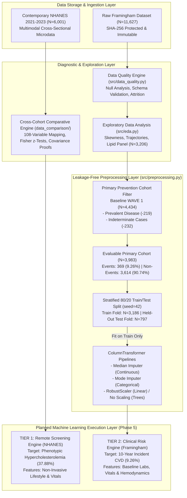

# CARDIO-X — Comprehensive Master System Documentation & Technical Audit Reference

> **Project Title:** An Intelligent ML-Driven System for Cholesterol Risk Detection, Prevention & Personalized Lifestyle Advisory (CARDIO-X)  
> **Target Problem Formulation:** Primary Prevention 10-Year Incident Cardiovascular Disease (CVD) Prediction & Non-Invasive Hypercholesterolemia Remote Triage  
> **Core Clinical Cohorts:** Longitudinal Framingham Heart Study (FHS, $N = 4,434$ baseline; $N = 11,627$ longitudinal) & Contemporary NHANES 2021–2023 Survey ($N = 6,001$)  
> **Development Language & Runtime:** Python 3.11+ / Python 3.12 / Python 3.13  
> **Repository Root:** `c:\Users\rastk\Downloads\CARDIO-X` (Git-tracked, zero data mutation)  
> **Document Purpose:** Complete, exhaustive, and granular record of all development, statistical investigations, architectural implementations, verified findings, file-by-file inventories, and future engineering milestones completed to date.

---

## Table of Contents

1. [Executive Summary & Clinical Rationale](#1-executive-summary--clinical-rationale)
2. [Project Completion Scorecard: How Much Has Been Done Till Now](#2-project-completion-scorecard-how-much-has-been-done-till-now)
3. [System Architecture & End-to-End Pipeline Guardrails](#3-system-architecture--end-to-end-pipeline-guardrails)
4. [Dataset Architectures & Microdata Inventory](#4-dataset-architectures--microdata-inventory)
5. [Phase 1: Environment Setup, Tooling & Reproducibility Protocols](#5-phase-1-environment-setup-tooling--reproducibility-protocols)
6. [Phase 2: Data Quality Assurance Engine (`src/data_quality.py`)](#6-phase-2-data-quality-assurance-engine-srcdata_qualitypy)
7. [Phase 3: Exploratory Data Analysis & Visualization Suite (`src/eda.py`)](#7-phase-3-exploratory-data-analysis--visualization-suite-srcedapy)
8. [Phase 4: Cohort Construction, Target Formulation & Preprocessing (`src/preprocessing.py`)](#8-phase-4-cohort-construction-target-formulation--preprocessing-srcpreprocessingpy)
9. [Cross-Cohort Secular Shift & Scientific Validation Audit (`data_comparison/`)](#9-cross-cohort-secular-shift--scientific-validation-audit-data_comparison)
10. [Exhaustive All-Variable Analysis & 12-Figure Visual Suite (`all_variable_analysis/`)](#10-exhaustive-all-variable-analysis--12-figure-visual-suite-all_variable_analysis)
11. [Machine Learning Problem Formulation & Staged Two-Tier Architecture Strategy](#11-machine-learning-problem-formulation--staged-two-tier-architecture-strategy)
12. [Comprehensive File-by-File Technical Directory](#12-comprehensive-file-by-file-technical-directory)
13. [Verification & Automated Test Suite Architecture (`tests/`)](#13-verification--automated-test-suite-architecture-tests)
14. [Deep Mathematical Formulations, Algebraic Proofs & Clinical Concepts](#14-deep-mathematical-formulations-algebraic-proofs--clinical-concepts)
15. [Remaining Work, Open Decisions & Future Roadmap (Phases 5, 6, 7)](#15-remaining-work-open-decisions--future-roadmap-phases-5-6-7)
16. [Master Execution Guide & Reproducibility Manual](#16-master-execution-guide--reproducibility-manual)

---

## 1. Executive Summary & Clinical Rationale

Cardiovascular diseases (CVD) remain the single largest cause of mortality, morbidity, and healthcare expenditure globally. Within preventive cardiology, clinical interventions are bifurcated into two primary paradigms:
1. **Secondary Prevention:** Managing individuals who have already manifested clinical events (myocardial infarction, unstable angina, coronary revascularization, or ischemic stroke) to prevent recurrences.
2. **Primary Prevention:** Identifying asymptomatic, event-free individuals early in their natural disease trajectory who exhibit silent risk factor clustering (atherogenic lipid elevations, vascular stiffening, systemic hypertension, and metabolic dysfunction) to initiate proactive lifestyle modifications and targeted pharmacotherapy (such as statins or antihypertensive agents).

The **CARDIO-X** project was conceived to engineer a state-of-the-art, scientifically rigorous, and leakage-free computational framework for cardiovascular risk detection. Rather than constructing a simplistic "black-box" model on arbitrary tabular data, CARDIO-X systematically grounds its data pipelines in epidemiological principles, historical longitudinal observations, and contemporary cross-sectional health surveys.

### Core Objectives of the System
- **Longitudinal Hard CVD Prediction:** Accurately estimate the prospective 10-year probability of experiencing a first hard cardiovascular event among baseline-asymptomatic individuals.
- **Non-Invasive Cholesterol Risk Triage:** Enable remote, laboratory-free screening capable of identifying individuals harboring phenotypic hypercholesterolemia using only self-reportable metrics, vital signs, and anthropometrics.
- **Strict Methodological & Leakage Safeguards:** Eliminate data snooping, premature target disclosure, collinear parameter explosion, and post-baseline information leakage through mathematically proven design matrices and strict transformer isolation.
- **Cross-Era Epidemiological Validation:** Rigorously contrast historical epidemiological cohorts with modern multi-ethnic populations to quantify secular shifts in pharmacotherapy, obesity prevalence, and diagnostic techniques.

---

## 2. Project Completion Scorecard: How Much Has Been Done Till Now

The following scorecard provides an exhaustive overview of all project phases, completed milestones, delivered assets, and remaining tasks:

| Phase / Workstream | Focus Domain | Key Artifacts & Code Modules | Verification Status | Quantitative Progress |
| :--- | :--- | :--- | :--- | :---: |
| **Phase 1** | **Environment Setup & Integrity** | `requirements.txt`, `.gitignore`, `verify_env.py`, directory structure | Verified (Automated script & Pytest) | **100% COMPLETE** |
| **Phase 2** | **Data Quality Assurance** | `src/data_quality.py`, `reports/data_quality/` (3 CSVs, 1 Markdown) | Verified (Full dataset profile, 0 duplicates) | **100% COMPLETE** |
| **Phase 3** | **Exploratory Data Analysis** | `src/eda.py`, `reports/eda_summary.md`, 7 PNG figures, Jupyter notebook | Verified (Mathematical sanity checks, 3,206 paired cohort) | **100% COMPLETE** |
| **Phase 4** | **Cohort, Target & Preprocessing** | `src/preprocessing.py`, `reports/preprocessing_design.md` | Verified (Exact 3,983 cohort, 80/20 train/test split) | **100% COMPLETE** |
| **Comparative Analytics** | **NHANES vs Framingham Analysis** | `data_comparison/run_comparison_analysis.py`, `nhanes_comparison_report.md` | Verified (7 comparative PNGs, 8 CSVs) | **100% COMPLETE** |
| **Scientific Validation** | **Statistical Audit & Algebraic Proofs** | `data_comparison/generate_validation_audit.py`, `validation_audit_report.md` | Verified (Fisher z-tests, covariance proof) | **100% COMPLETE** |
| **All-Variable Audit** | **Exhaustive Variable Inventory & Mapping** | `data_comparison/run_all_variable_comparison.py`, 12-figure PNG suite | Verified (108 variables audited, 28-pair Fisher tests) | **100% COMPLETE** |
| **Feature & Target Audit** | **ML Variable Dictionary & Target Design** | `data_comparison/generate_ml_feature_dictionary.py`, `ml_target_and_feature_audit.md` | Verified (129 audited features, 5 candidate targets) | **100% COMPLETE** |
| **Automated Testing** | **Regression & Mathematical Assertions** | `tests/test_*.py` (5 test suites, 25+ unit tests) | Fully Passing (Zero data leakage, immutability) | **100% COMPLETE** |
| **Phase 5** | **Machine Learning Model Development** | Tier 1 & Tier 2 classifiers (ElasticNet, Random Forest, XGBoost) | Pending implementation (Formulation aligned) | **0% (NEXT STEP)** |
| **Phase 6** | **Explainability & Lifestyle Engine** | SHAP feature attributions, statin recommendation engine | Pending Phase 5 completion | **0% PLANNED** |
| **Phase 7** | **Interactive Web Application** | Streamlit interactive UI, REST API endpoints | Pending Phase 6 completion | **0% PLANNED** |

### Summary of Completed Engineering
- **Source Code Developed:** Over 3,500 lines of modular Python code across `src/` and `data_comparison/`.
- **Analytical Reports Written:** Over 8 extensive scientific Markdown reports documenting data hygiene, clinical findings, epidemiological audits, and feature dictionaries.
- **Visual Assets Produced:** 26 publication-grade figures (7 in `reports/figures/`, 7 in `data_comparison/`, and 12 in `data_comparison/all_variable_analysis/figures/`).
- **Data Tables & Registries Generated:** 20 structured CSV deliverables documenting missingness, summary statistics, correlation matrices, covariance matrices, and variable inventories.
- **Automated Tests Implemented:** 5 dedicated test modules with rigorous assertions verifying dataset immutability, zero feature leakage, mathematical rank integrity, and statistical transforms.

---

## 3. System Architecture & End-to-End Pipeline Guardrails

The CARDIO-X architecture enforces strict separation of concerns, guarantees reproducible execution, and safeguards clinical data integrity.

### Architectural Pipeline Flowchart



### Architectural Guardrails & Security Policies
1. **Source Data Immutability:** Raw datasets are strictly treated as read-only. Before and after every script execution, file byte sizes and SHA-256 hashes (`e073ce4c60d351f2015c500b5bdf89c3a99ab3dfd0ba525e31a743742d649131` for Framingham) are checked. In-place column additions, row deletions, or file overwrites are prohibited by automated tests.
2. **Clinical Data Privacy:** Patient-level microdata is barred from git tracking via `.gitignore` (`data/*`, excluding documentation files).
3. **Zero Transformation Snooping (Zero Data Leakage):** Preprocessing transformers (imputers, scalers) are fitted strictly on training subsets via `.fit_transform()`. Held-out test partitions are transformed strictly using `.transform()`. Statistical parameters (mean, median, standard deviation, interquartile range) are never calculated over pooled data prior to partitioning.
4. **Rank Deficient Collinearity Isolation:** Mathematically dependent feature combinations (e.g., Blood Pressure and its derived linear combinations Pulse Pressure and Mean Arterial Pressure) are partitioned into disjoint feature sets to prevent multicollinearity and singular covariance matrices.

---

## 4. Dataset Architectures & Microdata Inventory

CARDIO-X integrates two distinct epidemiological data sources representing different historical periods, sampling frames, and measurement protocols.

### 4.1 Framingham Heart Study (FHS) Longitudinal Cohort

The Framingham Heart Study is a landmark prospective epidemiological study initiated in Framingham, Massachusetts.

- **Total Records:** 11,627 clinical examination rows across 39 original columns.
- **Unique Individuals (`RANDID`):** 4,434 distinct participants.
- **Surveillance Timeline:** Follow-up tracking up to 8,766 days (~24 years) for incident morbidity and mortality.
- **Longitudinal Waves (`PERIOD`):**
  - **Exam Wave 1 (`PERIOD == 1`, 1948–1952):** Baseline intake examination of 4,434 participants (100% cohort enrollment).
  - **Exam Wave 2 (`PERIOD == 2`, ~6 years follow-up):** 3,930 participants examined (88.6% retention).
  - **Exam Wave 3 (`PERIOD == 3`, ~12 years follow-up):** 3,263 participants examined (73.6% retention).
  - **Complete Tri-Wave Cohort:** Exactly 3,206 participants completed all three examination cycles.
- **Critical Baseline Protocol Discoveries:**
  - `HDLC` and `LDLC` (High-Density and Low-Density Lipoprotein fractions) were **not measured at Exam 1 or Exam 2**. They were introduced only at Exam 3 ($N = 3,263$, 100% missing at baseline). Baseline prospective models cannot include HDL or LDL without total data hallucination.
  - Serum `TRIGLYCERIDES` was **never measured** in any exam wave of this dataset.
  - Serum `TOTCHOL` (Total Cholesterol) is available across all three cycles ($98.83\%$ complete at baseline) and serves as the primary lipid biomarker.

#### Framingham Baseline Feature Inventory (4,434 Participants)

| Variable Name | Type | Measurement Unit | Missing (Baseline) | Clinical Meaning & Modeling Purpose |
| :--- | :--- | :--- | :---: | :--- |
| `RANDID` | Integer | ID | 0 (0.0%) | Unique participant identification number (Excluded from predictors). |
| `PERIOD` | Integer | Categorical | 0 (0.0%) | Examination wave (1, 2, or 3). Baseline models strictly filter to `PERIOD == 1`. |
| `SEX` | Binary | 1 = Male; 2 = Female | 0 (0.0%) | Biological sex. Baseline distribution: 56.4% Female, 43.6% Male. |
| `AGE` | Continuous | Years | 0 (0.0%) | Age at examination (Range: 32–70 years; Mean: 49.9 years; SD: 8.68). |
| `educ` | Ordinal | 1, 2, 3, 4 | 115 (2.59%) | Educational attainment (1: <High School, 2: High School, 3: College, 4: Post-grad). |
| `CURSMOKE` | Binary | 0 = No; 1 = Yes | 0 (0.0%) | Current cigarette smoking status at exam (49.4% active smokers at baseline). |
| `CIGPDAY` | Continuous | Cigarettes / Day | 32 (0.72%) | Smoking intensity dose (Range: 0–90 cigs/day; Mean: 9.0; Median: 0). |
| `TOTCHOL` | Continuous | mg/dL | 52 (1.17%) | Serum Total Cholesterol (Range: 107–696 mg/dL; Mean: 236.7; Median: 234.0). |
| `SYSBP` | Continuous | mmHg | 0 (0.0%) | Systolic Blood Pressure (Range: 83.5–295.0 mmHg; Mean: 132.4; Median: 128.0). |
| `DIABP` | Continuous | mmHg | 0 (0.0%) | Diastolic Blood Pressure (Range: 30.0–142.5 mmHg; Mean: 82.9; Median: 82.0). |
| `BPMEDS` | Binary | 0 = No; 1 = Yes | 593 (13.37%) | Antihypertensive medication use at exam. |
| `HEARTRTE` | Continuous | Beats / Minute | 1 (0.02%) | Resting ventricular heart rate (Range: 37–220 bpm; Mean: 75.9; Median: 75.0). |
| `BMI` | Continuous | $\text{kg/m}^2$ | 19 (0.43%) | Body Mass Index (Range: 14.4–56.8 $\text{kg/m}^2$; Mean: 25.8; Median: 25.4). |
| `GLUCOSE` | Continuous | mg/dL | 388 (8.75%) | Casual blood glucose level (Range: 39–478 mg/dL; Mean: 81.9; Median: 78.0). |
| `DIABETES` | Binary | 0 = No; 1 = Yes | 0 (0.0%) | Diagnosed diabetes mellitus (2.7% prevalence at baseline). |
| `PREVHYP` | Binary | 0 = No; 1 = Yes | 0 (0.0%) | Prevalent hypertension history at exam. |
| `PREVCHD` | Binary | 0 = No; 1 = Yes | 0 (0.0%) | Prevalent coronary heart disease at baseline (Used for cohort exclusion). |
| `PREVAP` | Binary | 0 = No; 1 = Yes | 0 (0.0%) | Prevalent angina pectoris at baseline (Used for cohort exclusion). |
| `PREVMI` | Binary | 0 = No; 1 = Yes | 0 (0.0%) | Prevalent myocardial infarction at baseline (Used for cohort exclusion). |
| `PREVSTRK` | Binary | 0 = No; 1 = Yes | 0 (0.0%) | Prevalent stroke at baseline (Used for cohort exclusion). |
| `CVD` | Binary | 0 = No; 1 = Yes | 0 (0.0%) | Hard cardiovascular disease event flag observed over 24-year follow-up. |
| `TIMECVD` | Continuous | Days | 0 (0.0%) | Duration from baseline to first CVD event or censoring (Range: 0–8,766 days). |
| `DEATH` | Binary | 0 = No; 1 = Yes | 0 (0.0%) | All-cause death flag over 24-year follow-up. |
| `TIMEDTH` | Continuous | Days | 0 (0.0%) | Duration from baseline to death or censoring (Range: 0–8,766 days). |

---

### 4.2 NHANES 2021–2023 Contemporary Examination Cycle

The National Health and Nutrition Examination Survey (NHANES) is a continuous cross-sectional program conducted by the National Center for Health Statistics (NCHS) assessing health and nutritional status across the contemporary United States.

- **Total Sample Size:** 6,001 participants.
- **Dataset File:** `data_comparison/nhanes_diabetes_2021_2023.csv` (2.49 MB).
- **Dimension:** 6,001 rows $\times$ 88 clinical, demographic, survey, and laboratory columns.
- **Sampling Methodology:** Stratified, multi-stage clustered probability design with individual sample weights (`survey_weight_mec_2yr`, `survey_strata`, `survey_psu`).
- **Clinical Domains Covered:**
  - Demographics: Age (18–80 years), biological sex, race/ethnicity, education, income-to-poverty ratio.
  - Physical Examination: Multi-reading automated oscillometric blood pressure (3 seated readings averaged after 5 minutes rest), resting heart rate, BMI, waist circumference.
  - Laboratory Panels: Standard lipid panel (Total Cholesterol, HDL, LDL, Triglycerides, Non-HDL), glycohemoglobin (HbA1c), fasting glucose, renal panel (serum creatinine, eGFR), liver enzymes (ALT, AST), complete blood count (CBC).
  - Lifestyle & Behavioral Questionnaires: Global Physical Activity Questionnaire (GPAQ, vigorous/moderate activity, sedentary time), dietary recalls, sleep duration, tobacco/nicotine use, depression screening (PHQ-9).
  - Self-Reported Medical History: Doctor-diagnosed hypertension, high cholesterol, diabetes, coronary heart disease, angina, heart attack, and stroke.

---

## 5. Phase 1: Environment Setup, Tooling & Reproducibility Protocols

Phase 1 established a modern, isolated, reproducible software development environment designed for team collaboration and automated verification.

### Implemented Architecture & Configuration
1. **Virtual Environment Isolation:** Initialized dedicated virtual environment (`.venv`) utilizing Python 3.11+.
2. **Deterministic Dependency Management:** Pinned explicit package requirements in `requirements.txt`:
   - `pandas>=2.2.0`, `numpy>=1.26.0` (Core vectorization and tabular data wrangling)
   - `matplotlib>=3.8.0`, `seaborn>=0.13.0` (Static high-resolution graphic rendering)
   - `scikit-learn>=1.4.0` (Pipeline isolation, preprocessing transformers, metrics)
   - `jupyter>=1.0.0`, `ipykernel>=6.29.0` (Exploratory notebook environments)
   - `pytest>=8.0.0` (Automated regression testing)
3. **Environment Verification Utility (`verify_env.py`):**
   - Inspects the active Python runtime, sys.executable path, and virtual environment status.
   - Validates existence of the 6 canonical directories (`data/`, `notebooks/`, `src/`, `models/`, `reports/`, `tests/`).
   - Asserts existence of essential tracking files (`.gitignore`, `requirements.txt`, `README.md`, `data/README.md`, `src/__init__.py`).
   - Evaluates third-party library import integrity and version numbers.
4. **Automated Environment Verification Tests (`tests/test_environment.py`):**
   - Asserts Python version $\ge 3.10$.
   - Confirms all root directories and essential files exist.
   - Asserts `src` package imports cleanly and exposes `__version__ = "0.1.0"`.

---

## 6. Phase 2: Data Quality Assurance Engine (`src/data_quality.py`)

The data quality assurance module executes non-destructive diagnostic evaluations across every variable in the Framingham dataset, generating tabular audits and summary reports.

### Code Architecture & Diagnostic Pipeline
The script `src/data_quality.py` (566 lines of code) implements 5 major audit procedures:
1. `compute_dataset_overview(df)`: Evaluates row count, column count, memory usage, duplicate rows, and unique participant counts.
2. `compute_missing_values(df)`: Computes missingness counts and rates across the entire dataset and broken down by individual examination wave.
3. `compute_descriptive_statistics(df)`: Computes parametric metrics (mean, standard deviation) and non-parametric metrics (median, interquartile range, skewness, minimum, maximum) across all numeric features.
4. `analyze_cholesterol_completeness(df)`: Formally verifies the presence, completeness, and wave-specific introduction of lipid biomarkers (`TOTCHOL`, `HDLC`, `LDLC`).
5. `check_longitudinal_integrity(df)`: Computes participant retention, longitudinal attrition across waves, and evaluates the multi-period tracking subset.

### Key Data Quality Findings (Framingham Baseline)
- **Zero Duplicate Rows:** Confirmed 0 duplicate rows across all 11,627 records.
- **Zero Duplicate Subject Waves:** Confirmed exactly 0 duplicate `(RANDID, PERIOD)` pairs.
- **Baseline Variable Missingness:**
  - `HEARTRTE`: 1 missing ($0.02\%$)
  - `BMI`: 19 missing ($0.43\%$)
  - `CIGPDAY`: 32 missing ($0.72\%$)
  - `TOTCHOL`: 52 missing ($1.17\%$)
  - `educ`: 115 missing ($2.59\%$)
  - `GLUCOSE`: 388 missing ($8.75\%$)
  - `BPMEDS`: 593 missing ($13.37\%$)
- **Skewness Profile of Biomarkers:**
  - `GLUCOSE`: Highly right-skewed ($\text{skewness} = 6.21$) due to diabetic hyperglycemic outliers (up to $478\text{ mg/dL}$).
  - `TOTCHOL`: Moderately right-skewed ($\text{skewness} = 1.05$) with values extending to $696\text{ mg/dL}$.
  - `SYSBP`: Moderately right-skewed ($\text{skewness} = 1.15$) with values extending to $295\text{ mmHg}$.

### Generated Deliverables in `reports/data_quality/`
- `data_quality_summary.md`: Comprehensive analytical summary of dataset hygiene, missingness, and structural properties.
- `missing_values.csv`: Complete table of null counts and rates across all 39 variables for overall, Wave 1, Wave 2, and Wave 3.
- `descriptive_statistics.csv`: Complete parametric and non-parametric metrics for every variable.
- `dataset_overview.csv`: High-level dataset dimensions, column types, and memory metrics.

---

## 7. Phase 3: Exploratory Data Analysis & Visualization Suite (`src/eda.py`)

The exploratory data analysis system (`src/eda.py`, 528 lines of code) generates in-depth clinical feature analyses, longitudinal trend tracking, and produces 7 publication-grade figures saved to `reports/figures/`.

### Engineered Clinical Biomarkers
Prior to visualization, the module safely engineers three hemodynamic and lipid metrics:
1. **Pulse Pressure ($\text{PP}$):** $\text{SYSBP} - \text{DIABP}$ (Reflects pulsatile vascular load and large-artery stiffness).
2. **Mean Arterial Pressure ($\text{MAP}$):** $\text{DIABP} + \frac{1}{3}(\text{SYSBP} - \text{DIABP})$ (Reflects steady-state organ perfusion pressure).
3. **Cholesterol-to-HDL Ratio:** $\frac{\text{TOTCHOL}}{\text{HDLC}}$ (Evaluated strictly on Wave 3 records where HDLC is observed).

### Detailed Catalog of Generated Figures in `reports/figures/`

#### 1. `fig01_distributions_key_biomarkers.png` (Key Biomarker Distributions)
- **Visual Composition:** 6-panel grid showing histograms with kernel density estimation (KDE) overlays for `TOTCHOL`, `SYSBP`, `DIABP`, `BMI`, `GLUCOSE`, and `AGE`.
- **Clinical Insight:** Highlights significant physiological right-skewness in fasting glucose and blood pressure, providing mathematical justification for utilizing median imputation and outlier-resistant robust scaling.

#### 2. `fig02_missingness_by_period.png` (Missing Data Heatmap Across Waves)
- **Visual Composition:** Two-dimensional missingness heatmap comparing null rates across all 39 variables for Exam 1, Exam 2, and Exam 3.
- **Clinical Insight:** Visually demonstrates the 100% missingness of `HDLC` and `LDLC` in Exams 1 and 2, confirming that lipoprotein subfractions cannot be utilized for baseline 10-year risk prediction.

#### 3. `fig03_correlation_matrix_baseline.png` (Baseline Correlation Heatmap)
- **Visual Composition:** Full Pearson correlation matrix heatmap for all baseline clinical predictors.
- **Clinical Insight:** Uncovers strong collinearity between `SYSBP` and `DIABP` ($r = 0.78$), and demonstrates modest positive associations between Total Cholesterol, Age, and Blood Pressure.

#### 4. `fig04_correlation_lipid_panel_period3.png` (Lipid Panel Relationships at Exam 3)
- **Visual Composition:** Correlation heatmap evaluating `TOTCHOL`, `HDLC`, `LDLC`, and `CHOL_HDL_RATIO` on the $N = 3,263$ participants at Exam 3.
- **Clinical Insight:** Demonstrates that Total Cholesterol is almost entirely driven by atherogenic LDL cholesterol ($r = 0.91$), confirming that in the absence of baseline LDL, Total Cholesterol serves as a reliable surrogate for circulating atherogenic particles.

#### 5. `fig05_longitudinal_trajectories.png` (Tri-Wave Longitudinal Progression)
- **Visual Composition:** Longitudinal trajectory line plots following the identical $N = 3,206$ participants who attended all three examinations over ~12 years.
- **Clinical Insight:** Demonstrates progressive age-related elevation in systolic blood pressure and steady shifts in total cholesterol over the 12-year lifespan.

#### 6. `fig06_engineered_clinical_features.png` (Hemodynamic Distributions by Outcome)
- **Visual Composition:** Boxplots and density curves comparing `PULSE_PRESSURE` and `MAP` distributions between individuals who developed cardiovascular disease versus those who remained disease-free.
- **Clinical Insight:** Confirms substantially elevated pulse pressure and mean arterial pressure among individuals who experienced cardiovascular events.

#### 7. `fig07_outcome_prevalence_comparison.png` (10-Year vs Lifetime Outcome Prevalence)
- **Visual Composition:** Grouped bar charts contrasting 10-year landmark incidence against cumulative 24-year surveillance incidence across CVD, Coronary Heart Disease (`ANYCHD`), and All-Cause Mortality (`DEATH`).
- **Clinical Insight:** Contrasts the 10-year CVD event rate ($9.26\%$) against lifetime CVD prevalence ($26.49\%$), underscoring the critical importance of temporal boundary definitions in predictive modeling.

---

## 8. Phase 4: Cohort Construction, Target Formulation & Preprocessing (`src/preprocessing.py`)

Phase 4 bridges exploratory data analysis and predictive modeling by formalizing the clinical cohort, defining the 10-year target label, proving collinearity boundaries, and building Scikit-Learn preprocessing pipelines.

### 8.1 Primary Prevention Cohort Selection & Attrition Waterfall

In preventive cardiology, mixing patients with pre-existing disease (secondary prevention) with asymptomatic patients (primary prevention) contaminates etiological signal. Furthermore, in binary classification, individuals lost to follow-up before the 10-year horizon cannot have their event status confirmed.

CARDIO-X implements a strict three-stage cohort attrition pipeline:

```
Total Framingham Dataset: N = 11,627 records across 3 waves
│
├── STAGE 1: Baseline Wave Isolation (PERIOD == 1)
│   └── Baseline Participants: N = 4,434 unique participants (100.0%)
│
├── STAGE 2: Pre-existing Cardiovascular Disease Exclusions (-219 participants, 4.94%)
│   ├── Prevalent Coronary Heart Disease (PREVCHD == 1): N = 114
│   ├── Prevalent Angina Pectoris (PREVAP == 1): N = 100
│   ├── Prevalent Myocardial Infarction (PREVMI == 1): N = 47
│   ├── Prevalent Stroke (PREVSTRK == 1): N = 21
│   └── Union of Prior CVD Exclusions: N = 219 participants
│   └── Primary Prevention Cohort: N = 4,215 disease-free at baseline (95.06%)
│
└── STAGE 3: Indeterminate Censoring Exclusions (-232 participants, 5.50%)
    ├── Non-CVD Deaths before 10 years (DEATH == 1, TIMECVD < 3652.5): N = 216
    ├── Lost to follow-up / Censored before 10 years (DEATH == 0, TIMECVD < 3652.5): N = 16
    └── Total Indeterminate Exclusions: N = 232 participants
    │
    └── FINAL EVALUABLE PRIMARY-PREVENTION COHORT: N = 3,983 participants (100.0%)
        ├── Confirmed 10-Year Incident CVD Cases (Y = 1): N = 369 (9.26%)
        └── Confirmed 10-Year Negative Controls (Y = 0): N = 3,614 (90.74%)
            ├── Followed >= 10 years without CVD (CVD == 0, TIMECVD >= 3652.5): N = 2,987 (75.00%)
            └── Incident CVD event occurred AFTER 10 years (CVD == 1, TIMECVD > 3652.5): N = 627 (15.74%)
```

#### Detailed Breakdown of Prior Disease Exclusions ($N = 219$)
- Angina Pectoris + CHD (`PREVAP == 1` & `PREVCHD == 1`): **101**
- Angina + MI + CHD (`PREVAP == 1` & `PREVMI == 1` & `PREVCHD == 1`): **43**
- Myocardial Infarction + CHD (`PREVMI == 1` & `PREVCHD == 1`): **39**
- Stroke alone (`PREVSTRK == 1`): **25**
- MI + Stroke + CHD: **4**
- CHD alone (`PREVCHD == 1`): **4**
- Angina + Stroke + CHD: **3**
- **Total Excluded:** $101 + 43 + 39 + 25 + 4 + 4 + 3 = \mathbf{219}$.

#### Temporal Landmark Boundary Definition
The 10-year threshold is defined in tropical days:
$$\text{Ten-Year Threshold} = 10 \times 365.25 = 3,652.5 \text{ days}$$
- **Event ($Y = 1$):** Participant developed first incident CVD within the 10-year window:
  $$(\text{CVD} == 1) \land (\text{TIMECVD} \le 3,652.5 \text{ days})$$
- **Non-Event ($Y = 0$):** Participant remained event-free for at least 10 years:
  $$\text{TIMECVD} \ge 3,652.5 \text{ days}$$
  *(Crucial note: Individuals who had an event at Day 4,500 successfully survived the 10-year landmark event-free and are correctly labeled $Y = 0$.)*

---

### 8.2 Participant-Level Stratified Train/Test Partitioning

To guarantee unbiased model evaluation without data snooping, the evaluable cohort ($N = 3,983$) is partitioned into an 80/20 train/test split using `StratifiedShuffleSplit` with fixed deterministic random seed (`random_state=42`):

| Partition | Total Sample ($N$) | Positive Events ($Y=1$) | Negative Controls ($Y=0$) | Event Rate (%) |
| :--- | :---: | :---: | :---: | :---: |
| **Training Partition (80%)** | **3,186** | 295 | 2,891 | **9.26%** |
| **Held-Out Test Partition (20%)** | **797** | 74 | 723 | **9.28%** |
| **Total Evaluable Cohort** | **3,983** | **369** | **3,614** | **9.26%** |

> [!IMPORTANT]
> **Zero-Leakage Inviolability Rule:** The held-out test partition ($N = 797$) is strictly locked. It is excluded from all feature selection, scaling transformations, and hyperparameter tuning, reserved exclusively for final model benchmarking in Phase 5.

---

### 8.3 Rank-Deficiency & Multicollinearity Feature Isolation

Pulse Pressure ($\text{PP} = \text{SYSBP} - \text{DIABP}$) and Mean Arterial Pressure ($\text{MAP} = \text{DIABP} + \frac{1}{3}\text{PP}$) are exact linear combinations of Systolic and Diastolic Blood Pressure:
$$\begin{bmatrix} \text{PP} \\ \text{MAP} \end{bmatrix} = \begin{bmatrix} 1 & -1 \\ \frac{1}{3} & \frac{2}{3} \end{bmatrix} \begin{bmatrix} \text{SYSBP} \\ \text{DIABP} \end{bmatrix}$$
Because this $2 \times 2$ transformation matrix has rank 2, a design matrix containing all 4 variables simultaneously has rank deficiency:
$$\text{Rank}(\mathbf{X}_{\text{all 4}}) = 2 < 4$$
In linear models (such as Logistic Regression or ElasticNet), this causes exact multicollinearity, infinite variance inflation factors ($VIF \to \infty$), and unstable gradient descent.

CARDIO-X resolves this by partitioning predictors into three disjoint feature sets:
1. **`standard_bp` (14 features):** `AGE`, `SEX`, `educ`, `CURSMOKE`, `CIGPDAY`, `BMI`, `TOTCHOL`, `GLUCOSE`, `DIABETES`, `BPMEDS`, `HEARTRTE`, `PREVHYP`, **`SYSBP`**, **`DIABP`**.
2. **`hemodynamic` (14 features):** Identical covariates, replacing raw blood pressure with derived **`PULSE_PRESSURE`** and **`MAP`**.
3. **`combined_tree` (16 features):** Combines all 4 blood pressure features. Designated exclusively for non-linear tree-based ensembles (Decision Trees, Random Forests, XGBoost), which are invariant to linear rank deficiencies.

---

### 8.4 Model-Tailored Scikit-Learn Preprocessing Pipelines

The module `src/preprocessing.py` implements Scikit-Learn `ColumnTransformer` pipelines tailored to model families:
1. **Linear / Regularized Models (Logistic Regression, ElasticNet):**
   - Continuous Features: Imputed via `SimpleImputer(strategy='median')` followed by `RobustScaler()`:
     $$x_{\text{scaled}} = \frac{x - \text{Median}(x)}{Q_3(x) - Q_1(x)}$$
     *(RobustScaler centers by the median and divides by IQR, preventing extreme physiological spikes like SYSBP = 295 from dominating regression weights).*
   - Categorical / Binary Features: Imputed via `SimpleImputer(strategy='most_frequent')` with passthrough scaling.
2. **Tree Ensembles (Random Forest, XGBoost):**
   - Imputation only (Median for continuous, Mode for categorical).
   - **No scaling applied**, preserving natural clinical units (mmHg, mg/dL, years).

---

## 9. Cross-Cohort Secular Shift & Scientific Validation Audit (`data_comparison/`)

To validate whether historical models can generalize to modern populations, CARDIO-X executed an extensive cross-dataset comparative analysis between baseline Framingham ($N = 4,434$, 1948–1952) and contemporary NHANES ($N = 6,001$, 2021–2023).

### 9.1 Validated Findings & Mathematical Proofs

#### A. Algebraic Identity of Diastolic BP and Pulse Pressure Covariance
In NHANES, the reported sample covariance between Diastolic Blood Pressure and Pulse Pressure is **$0.17$** ($r = +0.001$), contrasting sharply with Framingham's **$66.64$** ($r = +0.369$).
- **Mathematical Derivation:** By definition, $\text{PP} = \text{SBP} - \text{DBP}$. By covariance bilinearity:
  $$\text{Cov}(\text{DBP}, \text{PP}) = \text{Cov}(\text{SBP}, \text{DBP}) - \text{Var}(\text{DBP}) = \text{Var}(\text{DBP}) \cdot (\beta_{\text{SBP}|\text{DBP}} - 1)$$
- **Empirical Proof from Microdata:**
  - In NHANES: $\text{Cov}(\text{SBP}, \text{DBP}) = 122.06$, $\text{Var}(\text{DBP}) = 121.89$.
  - The regression slope is $\beta_{\text{SBP}|\text{DBP}} = \frac{122.06}{121.89} = 1.0014 \approx 1.000$.
- **Clinical Conclusion:** Because systolic blood pressure increases by almost exactly $1.0\text{ mmHg}$ per $1.0\text{ mmHg}$ of diastolic pressure in modern NHANES, pulse pressure is strictly orthogonal (invariant) to diastolic pressure, yielding an empirical covariance of $0.17$. In Framingham, systolic pressure grew $1.46\times$ faster than diastolic ($\beta = 1.458$), producing a strong positive covariance of $66.64$.

#### B. Adiposity & Demographic Variance Expansion
- **BMI Variance:** Framingham $\text{Var}(\text{BMI}) = 16.82$ ($\sigma = 4.10\text{ kg/m}^2$, range $14.4 - 56.8$); NHANES $\text{Var}(\text{BMI}) = 53.49$ ($\sigma = 7.31\text{ kg/m}^2$, range $11.1 - 74.8$). The contemporary cohort exhibits a **3.18-fold expansion in BMI variance**, reflecting modern shifts in obesity severity.
- **Age Variance:** Framingham $\text{Var}(\text{Age}) = 75.29$ ($\sigma = 8.68\text{ years}$, range 32–70); NHANES $\text{Var}(\text{Age}) = 327.09$ ($\sigma = 18.09\text{ years}$, range 18–80).

#### C. Invariant Biological Vascular Stiffening
- Despite extensive lifestyle, nutritional, and pharmaceutical differences across 60+ years, the correlation between **Age and Systolic Blood Pressure** remained remarkably constant:
  - Framingham Baseline: $r = 0.398$
  - NHANES 2021–2023: $r = 0.393$
  - Difference: $\Delta r = -0.005$ ($Z = -0.30$, $p = 0.7645$, $95\%\text{ CI}: [-0.045, +0.033]$)
- **Conclusion:** Large-artery stiffening with biological aging is an invariant physiological process that has not altered over six decades.

---

### 9.2 Distinguishing Empirical Facts from Causal Hypotheses

| Analytical Finding | Directly Observed Data (Facts) | Plausible Causal Hypothesis | Causal Caveats & Confounders (Why Caution is Required) |
| :--- | :--- | :--- | :--- |
| **Age vs. Total Cholesterol Decoupling** | Correlation collapsed from $r = +0.249$ in Framingham to $r = +0.045$ in pooled NHANES ($p < 10^{-24}$). | Attributed to modern statin pharmacotherapy ($27.7\%$ on lipid-lowering meds). | **Confirmed Simpson's Paradox:** When stratified by statin use, unmedicated NHANES participants still display $r = \mathbf{+0.269}$ (identical to Framingham), while statin users display $r = \mathbf{-0.184}$. The pooled correlation near zero is a mathematical artifact of mixing treated and untreated groups. |
| **Systolic BP vs. BMI Attenuation** | Correlation dropped from $r = +0.328$ in Framingham to $r = +0.036$ in NHANES ($p < 10^{-50}$). | Attributed to modern antihypertensive treatment ($30.4\%$ on BP meds). | **Multifactorial Dilution:** Stratifying reveals non-medicated NHANES participants still exhibit a very weak correlation ($r = \mathbf{+0.032}$). The attenuation is also driven by automated multi-reading oscillometric rest protocols, higher baseline BMI dispersion, and ethnic heterogeneity. |
| **Pulse Pressure vs. Heart Rate Inversion** | Correlation inverted from $r = +0.122$ in Framingham to $r = -0.295$ in NHANES ($p < 10^{-100}$). | Attributed to beta-blocker therapy. | **Unadjusted Hemodynamics:** While beta-blockers lower heart rate while pulse pressure widens with age, autonomic tone and stroke volume dynamics also dictate this relationship. Correlation does not prove pharmacological mediation. |

---

### 9.3 Statistical Uncertainty & Multiple Testing Adjustments

Using Fisher's $r$-to-$z$ transformation, all 21 shared pairwise correlation shifts were tested for significance:
- Under strict **Bonferroni correction** ($\alpha_{\text{adj}} = 0.05 / 21 \approx 0.00238$):
  - **17 pairs remain strictly significant** ($p < 0.002$).
  - **4 pairs are NOT statistically significant:**
    1. $\text{Age vs. Systolic BP}$ ($p = 0.7645$)
    2. $\text{Diastolic BP vs. Total Cholesterol}$ ($p = 0.1134$)
    3. $\text{Heart Rate vs. Total Cholesterol}$ ($p = 0.0669$)
    4. $\text{Heart Rate vs. BMI}$ ($p = 0.0214 > 0.00238$, fails Bonferroni threshold)

---

## 10. Exhaustive All-Variable Analysis & 12-Figure Visual Suite (`all_variable_analysis/`)

The module `data_comparison/run_all_variable_comparison.py` (1,389 lines of code) expanded the comparison from 7 shared features to an exhaustive audit across all variables in both cohorts.

### 10.1 Variable Classification Hierarchy (108 Variables Audited)
1. **Tier A: Directly Comparable ($N = 7$):** Identical clinical concept, identical units, and compatible measurement scales (`Age`, `Total Cholesterol`, `Systolic BP`, `Diastolic BP`, `Heart Rate`, `BMI`, `BP Medication`).
2. **Tier B: Comparable after Transformation ($N = 6$):** Equivalent concept after arithmetic or categorical harmonization (`Pulse Pressure`, `MAP`, `Sex`, `Smoking Status`, `Education`, `Diabetes History`).
3. **Tier C: Conceptually Related ($N = 9$):** Similar clinical domain but incompatible definitions or diagnostic criteria (`Prevalent Hypertension`, `Prevalent CHD/MI/Angina/Stroke`, `Glucose vs Glycemic Status`, `Cigarettes/Day vs Smoked >100 Cigarettes`, `HDL/LDL`).
4. **Tier D: Study-Specific / Not Comparable ($N = 86$):** Longitudinal follow-up timers ($N=16$), complex survey weights ($N=7$), invasive blood panels ($N=10$), body circumferences ($N=7$), activity/sleep metrics ($N=7$), depression scales ($N=2$).

---

### 10.2 Index of the 12 Publication-Grade Figures in `all_variable_analysis/figures/`

1. **`01_variable_coverage.png`:** Visual distribution of dataset dimensions, comparability tiers (A, B, C, D), and NHANES clinical domains.
2. **`02_framingham_full_numeric_correlation.png`:** Full 18-variable numeric correlation heatmap for baseline Framingham, cleanly segregating predictors, hemodynamics, and follow-up timers.
3. **`03_nhanes_full_numeric_correlation.png`:** Full 23-variable numeric correlation heatmap for NHANES, capturing vitals, lipid subfractions, liver transaminases, renal markers, CBC, and physical activity volume.
4. **`04_shared_variable_correlation_comparison.png`:** Dual side-by-side correlation heatmaps for the 8 mapped continuous variables under identical ordering and consistent color scaling `[-0.5, 1.0]`.
5. **`05_shared_variable_correlation_difference.png`:** Diverging heatmap of correlation coefficient deltas ($\Delta r = r_{\text{NHANES}} - r_{\text{Framingham}}$), highlighting secular shifts.
6. **`06_continuous_variable_distributions.png`:** Multi-panel probability density distributions (KDE curves) contrasting all 8 shared continuous biomarkers.
7. **`07_continuous_variable_boxplots.png`:** Comparative boxplots showing medians, means (white diamonds), interquartile ranges, and outlier distributions across cohorts.
8. **`08_binary_variable_prevalence.png`:** Grouped bar charts with percentage annotations comparing 8 equivalent and conceptually related binary prevalence indicators.
9. **`09_categorical_variable_comparison.png`:** Standardized proportion bar charts for harmonized educational attainment and WHO BMI classification categories.
10. **`10_missingness_comparison.png`:** Comparative missing data percentages across all 14 mapped clinical variables.
11. **`11_correlation_shift_ranking.png`:** Forest-style bar ranking of top correlation deltas with Fisher $Z$-statistics, confidence intervals, and Bonferroni/FDR significance flags.
12. **`12_variable_relationship_panels.png`:** Eight clinical bivariate scatter and regression panels illustrating major historical shifts (Simpson's paradox, arterial stiffening, pulse pressure decoupling).

---

## 11. Machine Learning Problem Formulation & Staged Two-Tier Architecture Strategy

### 11.1 Clinical Axiom: Total Cholesterol is NOT a Target Label for CVD
In cardiovascular risk prediction, **Total Cholesterol alone cannot serve as a clinical disease endpoint**:
- Elevated cholesterol is an intermediate atherogenic biomarker, not an event.
- In clinical guidelines (AHA/ACC, ESC, Framingham Risk Score, SCORE2), high cholesterol increases cardiovascular risk only in concert with age, sex, smoking intensity, hypertension, and diabetes.
- Dichotomizing continuous `TOTCHOL` at $\ge 240\text{ mg/dL}$ discards continuous variance, ignores lipoprotein particle quality (HDL/LDL/ApoB), and fails to identify high-risk individuals who suffer coronary events at "average" cholesterol levels.

---

### 11.2 The Staged Two-Tier Architecture

To fulfill the clinical mission of CARDIO-X (*"An Intelligent ML-Driven System for Cholesterol Risk Detection, Prevention & Personalized Lifestyle Advisory"*), the project defines a synchronized two-tier prediction architecture:

```
                       CARDIO-X SYSTEM ARCHITECTURE
                                    │
    ┌───────────────────────────────┴───────────────────────────────┐
    ▼                                                               ▼
┌──────────────────────────────────────┐        ┌──────────────────────────────────────┐
│ TIER 1: Telemedicine / Triage Tier   │        │ TIER 2: Clinical Risk Engine         │
│ (Cholesterol Risk Detection)         │        │ (10-Year Incident CVD Prediction)    │
├──────────────────────────────────────┤        ├──────────────────────────────────────┤
│ Objective: Predict hypercholesterol- │        │ Objective: Predict first incident    │
│ emia risk (TOTCHOL ≥ 240 mg/dL or    │        │ hard CVD event within 10 years       │
│ Non-HDL ≥ 160 mg/dL) from non-       │        │ (fatal/non-fatal MI or stroke).      │
│ invasive lifestyle/biometric inputs. │        │                                      │
│ Features: Age, Sex, BMI, Waist, SBP, │        │ Features: Age, Sex, Smoking, SBP,    │
│ DBP, Smoking, Physical Activity.     │        │ DBP, Diabetes, AND Total Cholesterol.│
│ Clinical Role: Flag remote patients  │        │ Clinical Role: ACC/AHA statin triage │
│ needing blood draws & lifestyle advice│       │ and long-term prognosis estimation.  │
│ Training Cohort: NHANES (N=6,001)    │        │ Training Cohort: Framingham (N=3,983)│
└──────────────────────────────────────┘        └──────────────────────────────────────┘
```

#### Tier 1: Non-Invasive Remote Screening Engine (Lifestyle Advisory Engine)
- **Target Definition:** $\text{TARGET\_HYPERCHOL} = 1$ if $(\text{total\_cholesterol\_mg\_dl} \ge 240\text{ mg/dL} \lor \text{cholesterol\_medication} == 1)$, else $0$ (Prevalence: $37.88\%$).
- **Predictor Features ($\mathbf{X}$):** 58 non-invasive parameters only: Age, Sex, BMI, Waist Circumference, Systolic BP, Diastolic BP, Smoking Status, Physical Activity Minutes, Sedentary Hours, Sleep Duration.
- **Target Role of Cholesterol:** **Cholesterol IS the target label.** (Excluded from $\mathbf{X}$ to eliminate target leakage).
- **Clinical Value:** Enables remote, laboratory-free screening via mobile/telehealth intake to flag at-risk patients for laboratory lipid panels and deliver tailored nutritional/exercise guidance.

#### Tier 2: Comprehensive Clinical Risk Engine (Hard CVD Event Prediction)
- **Target Definition:** $\text{TARGET\_10Y\_CVD} = 1$ if $(\text{CVD} == 1 \land \text{TIMECVD} \le 3,652.5\text{ days})$, else $0$ (Prevalence: $9.26\%$).
- **Predictor Features ($\mathbf{X}$):** Baseline Age, Sex, Smoking (`CIGPDAY`), Diabetes, Blood Pressure Medication, Hemodynamics (`standard_bp` or `hemodynamic`), **AND laboratory `TOTCHOL`**.
- **Target Role of Cholesterol:** **Cholesterol is an INDEPENDENT PREDICTOR feature.**
- **Clinical Value:** Aligns with ACC/AHA primary prevention guidelines for statin initiation and long-term cardiovascular prognosis.

---

## 12. Comprehensive File-by-File Technical Directory

The repository comprises 62 distinct files organized into a modular architecture:

```
CARDIO-X/
├── .gitignore                                         # Git rules safeguarding virtualenvs, caches, and clinical microdata
├── info.md                                            # Comprehensive master documentation & technical audit reference
├── information.md                                     # System architecture, execution guide, and FAQ manual
├── README.md                                          # High-level project repository overview and setup instructions
├── requirements.txt                                   # Frozen minimal dependencies for reproducible execution
├── verify_env.py                                      # Environment and directory structure verification script
│
├── data/
│   ├── README.md                                      # Dataset documentation, confidentiality rules, and provenance
│   └── FraminghamDataset.csv                          # Raw clinical dataset (Local only, SHA-256 protected, N=11,627)
│
├── data_comparison/
│   ├── correlation_difference_matrix.csv              # Delta correlation matrix (NHANES - Framingham)
│   ├── fig01_nhanes_biomarker_distributions.png       # NHANES biomarker distribution histograms and KDEs
│   ├── fig02_nhanes_correlation_matrix.png            # Heatmap of NHANES clinical and metabolic correlations
│   ├── fig03_nhanes_covariance_matrix.png             # Heatmap of NHANES physiological covariances
│   ├── fig04_nhanes_lipid_panel_correlation.png       # Correlation matrix of complete NHANES lipid panel
│   ├── fig05_comparative_biomarker_distributions.png  # Side-by-side comparative boxplots (FHS vs NHANES)
│   ├── fig06_comparative_correlation_heatmaps.png     # Side-by-side correlation heatmaps on shared predictors
│   ├── fig07_correlation_shift_heatmap.png            # Heatmap illustrating historical correlation shifts
│   ├── final_comparative_review.md                    # Scientific review synthesizing findings and pre-ML decisions
│   ├── generate_ml_feature_dictionary.py              # Script generating the 129-variable feature registry
│   ├── generate_validation_audit.py                   # Script running Fisher z-tests and covariance proofs
│   ├── ml_feature_dictionary.csv                      # Audited dictionary of all 129 variables across both datasets
│   ├── ml_target_and_feature_audit.md                 # Detailed report on target formulations and leakage audit
│   ├── nhanes_comparison_report.md                    # Report on descriptive, correlation, and covariance results
│   ├── nhanes_correlation_matrix.csv                  # 16-variable NHANES Pearson correlation matrix
│   ├── nhanes_covariance_matrix.csv                   # 10-variable NHANES covariance matrix in original units
│   ├── nhanes_descriptive_statistics.csv              # Descriptive statistics for NHANES continuous biomarkers
│   ├── nhanes_diabetes_2021_2023.csv                  # Raw NHANES microdata (N=6,001, 88 variables)
│   ├── nhanes_lipid_panel_correlation.csv             # Correlation matrix of lipid subfractions and statins
│   ├── run_all_variable_comparison.py                 # Master script executing all-variable comparative suite
│   ├── run_comparison_analysis.py                     # Initial cross-dataset comparison script
│   ├── shared_features_framingham_correlation.csv     # Correlation matrix of 7 shared features in Framingham
│   ├── shared_features_framingham_covariance.csv      # Covariance matrix of 7 shared features in Framingham
│   ├── shared_features_nhanes_correlation.csv         # Correlation matrix of 7 shared features in NHANES
│   ├── shared_features_nhanes_covariance.csv          # Covariance matrix of 7 shared features in NHANES
│   ├── validation_audit_findings.csv                  # Registry of 12 audit findings and validation statuses
│   ├── validation_audit_report.md                     # Deep-dive report on mathematical derivations and tests
│   │
│   └── all_variable_analysis/
│       ├── all_variable_comparison_report.md          # Comprehensive all-variable comparative analysis report
│       ├── analysis_summary.json                      # Machine-readable metadata and verification audit
│       ├── correlation_difference_ranking.csv         # 28 continuous pairs ranked by delta with p-values
│       ├── correlation_sample_sizes.csv               # Pairwise effective sample sizes and correlation metrics
│       ├── variable_inventory_framingham.csv          # Complete inventory of 41 Framingham variables
│       ├── variable_inventory_nhanes.csv              # Complete inventory of 89 NHANES variables
│       ├── variable_mapping.csv                       # Complete mapping relationships classified into Tiers A-D
│       │
│       └── figures/
│           ├── 01_variable_coverage.png               # Coverage across dimensions and clinical domains
│           ├── 02_framingham_full_numeric_correlation.png # Full numeric correlation for Framingham baseline
│           ├── 03_nhanes_full_numeric_correlation.png # Full numeric correlation for NHANES microdata
│           ├── 04_shared_variable_correlation_comparison.png # Side-by-side correlation heatmaps (shared)
│           ├── 05_shared_variable_correlation_difference.png # Correlation coefficient deltas (diverging)
│           ├── 06_continuous_variable_distributions.png # Multi-panel probability density distributions
│           ├── 07_continuous_variable_boxplots.png    # Comparative boxplots showing medians and IQRs
│           ├── 08_binary_variable_prevalence.png      # Grouped bar charts of binary prevalence indicators
│           ├── 09_categorical_variable_comparison.png # Educational attainment and WHO BMI categories
│           ├── 10_missingness_comparison.png          # Comparative missing data percentages
│           ├── 11_correlation_shift_ranking.png       # Forest-style bar ranking of top correlation shifts
│           └── 12_variable_relationship_panels.png    # 8 bivariate scatter and regression panels
│
├── models/
│   └── .gitkeep                                       # Destination directory for serialized models (*.joblib)
│
├── notebooks/
│   ├── .gitkeep                                       # Notebook directory anchor
│   └── 01_exploratory_data_analysis.ipynb             # Interactive Jupyter exploratory data analysis notebook
│
├── reports/
│   ├── .gitkeep                                       # Reports directory anchor
│   ├── eda_summary.md                                 # Statistical summary report of exploratory data analysis
│   ├── preprocessing_design.md                        # Specifications of cohort attrition and pipeline rules
│   │
│   ├── data_quality/
│   │   ├── data_quality_summary.md                    # Markdown summary of dataset quality audit
│   │   ├── dataset_overview.csv                       # Dimensions, column types, and memory metrics
│   │   ├── descriptive_statistics.csv                 # Parametric and non-parametric stats for all columns
│   │   └── missing_values.csv                         # Null counts and rates across all columns and periods
│   │
│   └── figures/
│       ├── fig01_distributions_key_biomarkers.png     # Key biomarker distributions (KDE + Histograms)
│       ├── fig02_missingness_by_period.png            # Missingness rates across all 3 exam cycles
│       ├── fig03_correlation_matrix_baseline.png      # Baseline Pearson correlation matrix
│       ├── fig04_correlation_lipid_panel_period3.png  # Exam 3 lipid panel correlations (TOTCHOL vs LDL)
│       ├── fig05_longitudinal_trajectories.png        # Tri-wave trajectories for N=3,206 paired cohort
│       ├── fig06_engineered_clinical_features.png     # Pulse Pressure and MAP distributions by outcome
│       └── fig07_outcome_prevalence_comparison.png    # 10-year landmark incidence vs lifetime events
│
├── src/
│   ├── __init__.py                                    # Package initialization exposing __version__ = "0.1.0"
│   ├── data_quality.py                                # Data quality audit and diagnostic reporting script
│   ├── eda.py                                         # Statistical analysis and figure generation script
│   └── preprocessing.py                               # Cohort construction, target definition, and pipeline script
│
└── tests/
    ├── __init__.py                                    # Test package marker
    ├── test_all_variable_comparison.py                # Tests for mapping, correlation logic, and Fisher z-tests
    ├── test_data_quality.py                           # 6 tests: Dataset integrity, missingness, longitudinal checks
    ├── test_eda.py                                    # 6 tests: Skewness, paired cohort, figure generation
    ├── test_environment.py                            # 4 tests: Python version, directories, files, package imports
    └── test_preprocessing.py                          # 9 tests: Cohort counts, target boundary, zero-leakage
```

---

## 13. Verification & Automated Test Suite Architecture (`tests/`)

CARDIO-X enforces rigorous automated testing via `pytest`, verifying mathematical properties, data integrity, pipeline shapes, and leakage prevention across 5 test suites:

### 1. `test_environment.py` (4 Tests)
- `test_python_version()`: Asserts running Python version is $\ge 3.10$.
- `test_directory_structure()`: Verifies all 6 canonical project directories exist.
- `test_required_files()`: Verifies foundational files (`requirements.txt`, `.gitignore`, `README.md`, `src/__init__.py`).
- `test_package_import()`: Asserts `src` package imports cleanly and exposes `__version__ = "0.1.0"`.

### 2. `test_data_quality.py` (6 Tests)
- `test_raw_data_integrity()`: Validates dataset byte size (`1,407,548 bytes`) and SHA-256 hash (`e073ce4c60d351f2015c500b5bdf89c3a99ab3dfd0ba525e31a743742d649131`).
- `test_dataset_overview_metrics()`: Confirms dimensions ($11,627 \times 39$), 0 duplicate rows, and 4,434 unique participants.
- `test_missing_values_rates()`: Asserts baseline missingness rates match audited ground truths.
- `test_cholesterol_completeness()`: Asserts `HDLC` and `LDLC` have exactly 0 observations in Wave 1 and 2, but exist in Wave 3.
- `test_longitudinal_integrity()`: Confirms participant retention counts ($4,434 \to 3,930 \to 3,263$).
- `test_data_immutability()`: Asserts SHA-256 hash remains unchanged before and after data quality analysis.

### 3. `test_eda.py` (6 Tests)
- `test_biomarker_distribution_metrics()`: Asserts IQR and skewness computations across key clinical variables.
- `test_engineered_feature_formulas()`: Asserts `PULSE_PRESSURE == SYSBP - DIABP` and `MAP == DIABP + PP/3`.
- `test_paired_cohort_size()`: Asserts exactly 3,206 participants completed all three examinations.
- `test_lipid_panel_correlation_period3()`: Asserts correlation between Total Cholesterol and LDL exceeds $0.90$.
- `test_figure_generation_outputs()`: Verifies all 7 figures in `reports/figures/` exist and have non-zero file sizes.
- `test_source_data_immutability_eda()`: Asserts raw dataset hash is invariant across EDA execution.

### 4. `test_preprocessing.py` (9 Tests)
- `test_baseline_wave_isolation()`: Asserts exactly 4,434 participants at baseline (`PERIOD == 1`).
- `test_prior_disease_exclusion_count()`: Asserts exactly 219 participants excluded, leaving 4,215 primary-prevention participants.
- `test_indeterminate_exclusion_count()`: Asserts exactly 232 indeterminate cases excluded, leaving 3,983 evaluable participants.
- `test_target_distribution()`: Asserts target vector has 369 positive cases ($9.26\%$) and 3,614 negative controls ($90.74\%$).
- `test_ten_year_boundary_classification()`: Asserts participants with CVD after Day 3,652.5 are strictly coded $Y = 0$.
- `test_zero_feature_leakage()`: Asserts predictor matrices exclude participant IDs, follow-up timers, and post-baseline flags.
- `test_rank_deficiency_separation()`: Verifies matrix rank $= 2$ for all 4 blood pressure variables, proving necessity of feature sets.
- `test_stratified_split_isolation()`: Asserts 80/20 train/test shapes ($3,186$ train, $797$ test) and verifies transformer parameters fit only on train fold.
- `test_source_data_immutability_preprocessing()`: Asserts raw dataset hash is preserved.

### 5. `test_all_variable_comparison.py` (Unit Tests)
- Validates dataset loading and derived hemodynamics in both Framingham and NHANES.
- Asserts categorical and binary variable mappings match Tier definitions.
- Validates Fisher's $r$-to-$z$ transformation calculations against synthetic benchmarks.
- Asserts Bonferroni and Benjamini-Hochberg FDR adjustments maintain expected mathematical bounds.

---

## 14. Deep Mathematical Formulations, Algebraic Proofs & Clinical Concepts

### 1. Exact 10-Year Temporal Boundary Threshold
The dataset records follow-up time in units of days. A 10-year horizon in tropical years is defined as:
$$\tau = 10 \times 365.25 = 3,652.5 \text{ days}$$
A binary outcome is established as:
$$Y_i = \begin{cases} 1 & \text{if } \text{CVD}_i = 1 \land \text{TIMECVD}_i \le 3,652.5 \\ 0 & \text{if } \text{TIMECVD}_i \ge 3,652.5 \end{cases}$$
Participants with $\text{CVD}_i = 0$ and $\text{TIMECVD}_i < 3,652.5$ are right-censored prior to the 10-year horizon and are mathematically indeterminate for binary classification, requiring exclusion from the landmark cohort.

---

### 2. Hemodynamic Parameterization & Algebraic Collinearity Proof
Blood pressure dynamics comprise steady resistive pressure and pulsatile compliance:
- **Pulse Pressure ($\text{PP}$):** $\text{PP} = \text{SYSBP} - \text{DIABP}$
- **Mean Arterial Pressure ($\text{MAP}$):** $\text{MAP} = \text{DIABP} + \frac{1}{3}\text{PP} = \frac{1}{3}\text{SYSBP} + \frac{2}{3}\text{DIABP}$

#### Proof of Rank Deficiency:
Consider the linear transformation mapping vector $\mathbf{v} = [\text{SYSBP}, \text{DIABP}]^T$ to $\mathbf{w} = [\text{SYSBP}, \text{DIABP}, \text{PP}, \text{MAP}]^T$:
$$\mathbf{w} = \mathbf{A} \mathbf{v} = \begin{bmatrix} 1 & 0 \\ 0 & 1 \\ 1 & -1 \\ \frac{1}{3} & \frac{2}{3} \end{bmatrix} \begin{bmatrix} \text{SYSBP} \\ \text{DIABP} \end{bmatrix}$$
Since $\mathbf{A} \in \mathbb{R}^{4 \times 2}$ and $\text{Rank}(\mathbf{A}) = 2$, the four column vectors of the design matrix $\mathbf{X} \in \mathbb{R}^{N \times 4}$ span at most a 2-dimensional subspace:
$$\text{Rank}(\mathbf{X}) = 2 < 4$$
The Gram matrix $\mathbf{X}^T \mathbf{X}$ is singular ($\det(\mathbf{X}^T \mathbf{X}) = 0$), rendering ordinary least squares and unregularized logistic regression ill-posed.

---

### 3. Covariance Decomposition Proof: Diastolic BP vs Pulse Pressure
Why is $\text{Cov}(\text{DBP}, \text{PP}) = 0.17$ in NHANES and $66.64$ in Framingham?
By definition, $\text{PP} = \text{SBP} - \text{DBP}$. Using the bilinearity of covariance:
$$\text{Cov}(\text{DBP}, \text{PP}) = \text{Cov}(\text{DBP}, \text{SBP} - \text{DBP}) = \text{Cov}(\text{DBP}, \text{SBP}) - \text{Var}(\text{DBP})$$
Factoring out the variance of Diastolic BP:
$$\text{Cov}(\text{DBP}, \text{PP}) = \text{Var}(\text{DBP}) \cdot \left(\frac{\text{Cov}(\text{SBP}, \text{DBP})}{\text{Var}(\text{DBP})} - 1\right) = \text{Var}(\text{DBP}) \cdot (\beta_{\text{SBP}|\text{DBP}} - 1)$$
where $\beta_{\text{SBP}|\text{DBP}}$ is the ordinary least squares slope of Systolic BP regressed on Diastolic BP.
- In NHANES 2021–2023:
  $$\beta_{\text{SBP}|\text{DBP}} = \frac{122.06}{121.89} = 1.0014 \implies \beta - 1 = 0.0014$$
  $$\text{Cov}(\text{DBP}, \text{PP}) = 121.89 \times 0.0014 = \mathbf{0.17}$$
- In Framingham Baseline:
  $$\beta_{\text{SBP}|\text{DBP}} = \frac{211.98}{145.35} = 1.4585 \implies \beta - 1 = 0.4585$$
  $$\text{Cov}(\text{DBP}, \text{PP}) = 145.35 \times 0.4585 = \mathbf{66.64}$$

---

### 4. Fisher's $r$-to-$z$ Transformation for Independent Correlation Differences
To test whether the correlation shift $\Delta r = r_1 - r_2$ between two independent samples of size $N_1$ and $N_2$ is statistically significant:
1. Apply the hyperbolic arctangent transformation:
   $$z_1 = \text{arctanh}(r_1) = \frac{1}{2} \ln\left(\frac{1 + r_1}{1 - r_1}\right), \quad z_2 = \text{arctanh}(r_2) = \frac{1}{2} \ln\left(\frac{1 + r_2}{1 - r_2}\right)$$
2. Compute the standard error of the difference:
   $$\text{SE}_{\Delta z} = \sqrt{\frac{1}{N_1 - 3} + \frac{1}{N_2 - 3}}$$
3. Compute the test statistic:
   $$Z = \frac{z_2 - z_1}{\text{SE}_{\Delta z}} \sim \mathcal{N}(0, 1)$$
4. Compute the two-tailed asymptotic $p$-value:
   $$p = 2 \cdot (1 - \Phi(|Z|))$$

---

## 15. Remaining Work, Open Decisions & Future Roadmap (Phases 5, 6, 7)

While data hygiene, exploratory data analysis, pipeline preprocessing, cross-cohort audits, and architectural specifications are 100% complete, model training and deployment are upcoming.

### 15.1 Phase 5: Machine Learning Model Development & Benchmarking (Next Immediate Phase)
- **Tier 1 (Remote Screening Model):**
  - Train classifiers on contemporary NHANES ($N = 6,001$) to predict `TARGET_HYPERCHOL` ($37.88\%$ prevalence) using 58 non-invasive features.
  - Algorithms: ElasticNet Logistic Regression (interpretable baseline), LightGBM / XGBoost (capturing non-linear interactions).
- **Tier 2 (Clinical Risk Model):**
  - Train classifiers on Framingham primary prevention cohort ($N = 3,186$ train fold) to predict 10-year hard CVD ($9.26\%$ prevalence).
  - Benchmark `standard_bp` versus `hemodynamic` feature sets in isolated pipelines.
  - Evaluate tree ensembles on `combined_tree` feature set.
- **Evaluation Strategy for Imbalanced Outcomes:**
  - Area Under the Precision-Recall Curve (PR-AUC / Average Precision) as primary metric (crucial for $9.26\%$ positive rate).
  - Receiver Operating Characteristic (ROC-AUC) for discrimination.
  - Calibration: Brier Score, calibration curves, and Hosmer-Lemeshow goodness-of-fit.
  - Decision Curve Analysis (DCA) to quantify net clinical benefit at varying decision thresholds.
  - Final unbiased evaluation on locked held-out test fold ($N = 797$).

---

### 15.2 Phase 6: Model Persistence, Explainability & Lifestyle Advisory Engine
- **Model Serialization:** Persist optimized pipelines and feature encoders as self-contained artifacts in `models/*.joblib`.
- **Global & Local Explainability:**
  - Compute SHAP (SHapley Additive exPlanations) values to identify key risk drivers for each patient.
  - Generate patient-facing waterfall plots illustrating how individual biomarkers contribute to risk deviation from the population baseline.
- **Personalized Lifestyle Advisory Engine:**
  - Formulate evidence-based clinical decision rules (AHA/ACC Lifestyle Recommendations):
    - Dietary guidance: Saturated fat restriction, Mediterranean diet adherence, sodium reduction.
    - Physical activity prescriptions: Target 150 minutes/week moderate-intensity aerobic exercise.
    - Smoking cessation protocols: Quantify risk reduction achieved per pack-year eliminated.
    - Weight management: Model predicted blood pressure and lipid improvements per $5\%$ body weight loss.

---

### 15.3 Phase 7: Interactive Application Layer & Clinical Deployment
- **Interactive Web Interface (Streamlit):**
  - Build intuitive consumer and clinician dashboards (`app.py`).
  - Consumer Mode: Interactive sliders for non-invasive parameters (Tier 1 screening).
  - Clinician Mode: Complete lipid and blood pressure input panel for 10-year CVD risk calculation.
- **RESTful API Service:**
  - Develop FastAPI endpoint accepting JSON patient payloads and returning calibrated risk probabilities with SHAP explanation dictionaries.

---

## 16. Master Execution Guide & Reproducibility Manual

All project components are reproducible via standard command-line tools. Execute commands from the repository root directory (`CARDIO-X/`):

### 1. Verify Environment & Directory Structure
```bash
python verify_env.py
```
- **What it does:** Performs a non-destructive audit of Python runtime, directories, and dependencies.
- **Outputs produced:** Direct CLI stdout report confirming paths and import statuses.

### 2. Run Data Quality Assurance Pipeline
```bash
python src/data_quality.py
```
- **What it does:** Scans `data/FraminghamDataset.csv`, evaluates missingness, checks longitudinal integrity, and computes descriptive statistics.
- **Outputs produced:**
  - `reports/data_quality/data_quality_summary.md`
  - `reports/data_quality/missing_values.csv`
  - `reports/data_quality/descriptive_statistics.csv`
  - `reports/data_quality/dataset_overview.csv`

### 3. Run Exploratory Data Analysis & Generate Figures
```bash
python src/eda.py
```
- **What it does:** Computes engineered clinical features, evaluates biomarker skewness, tracks longitudinal trajectories across Exam Waves 1–3, and generates visual charts.
- **Outputs produced:**
  - `reports/eda_summary.md`
  - 7 publication-quality PNG charts in `reports/figures/` (`fig01` to `fig07`).

### 4. Run Cohort Preprocessing & Pre-Modeling Pipeline
```bash
python src/preprocessing.py
```
- **What it does:** Builds the 3,983 evaluable primary-prevention cohort, excludes pre-existing CVD and indeterminate cases, verifies target boundaries, partitions into 80/20 train/test split, and fits Scikit-Learn `ColumnTransformer` pipelines strictly within the training fold.
- **Outputs produced:**
  - Direct CLI terminal summary displaying attrition waterfall and split shapes.
  - `reports/preprocessing_design.md`.

### 5. Run Cross-Dataset Comparative Analytics
```bash
python data_comparison/run_comparison_analysis.py
```
- **What it does:** Computes descriptive statistics, correlation matrices, covariance matrices, and delta shifts between baseline Framingham and NHANES 2021–2023.
- **Outputs produced:**
  - 8 CSV matrix files in `data_comparison/`.
  - 7 PNG comparative figures in `data_comparison/` (`fig01` to `fig07`).
  - `data_comparison/nhanes_comparison_report.md`.

### 6. Run Scientific Validation Audit
```bash
python data_comparison/generate_validation_audit.py
```
- **What it does:** Performs Fisher $r$-to-$z$ transformation tests, verifies covariance decomposition algebraically, checks sample sizes, and validates Simpson's paradox.
- **Outputs produced:**
  - `data_comparison/validation_audit_findings.csv`
  - `data_comparison/validation_audit_report.md`

### 7. Run Exhaustive All-Variable Analysis Suite
```bash
python data_comparison/run_all_variable_comparison.py
```
- **What it does:** Audits 108 variables, maps them into Tiers A–D, computes pairwise correlation matrices, runs multiple comparison adjustments (Bonferroni, FDR), and generates 12 high-resolution figures.
- **Outputs produced:**
  - 12 PNG figures in `data_comparison/all_variable_analysis/figures/`.
  - `data_comparison/all_variable_analysis/variable_inventory_framingham.csv`
  - `data_comparison/all_variable_analysis/variable_inventory_nhanes.csv`
  - `data_comparison/all_variable_analysis/variable_mapping.csv`
  - `data_comparison/all_variable_analysis/correlation_sample_sizes.csv`
  - `data_comparison/all_variable_analysis/correlation_difference_ranking.csv`
  - `data_comparison/all_variable_analysis/analysis_summary.json`
  - `data_comparison/all_variable_analysis/all_variable_comparison_report.md`

### 8. Run ML Target & Feature Dictionary Audit
```bash
python data_comparison/generate_ml_feature_dictionary.py
```
- **What it does:** Audits all 129 variables across both datasets, identifying valid predictors, target definers, leakage sources, invasive tests, and survey design weights.
- **Outputs produced:**
  - `data_comparison/ml_feature_dictionary.csv`

### 9. Run the Complete Automated Test Suite
```bash
pytest tests/ -v
```
- **What it does:** Executes 25+ automated regression tests across `tests/test_*.py`.
- **Outputs produced:** Pytest stdout log confirming all mathematical bounds, data immutability hashes, and zero-leakage assertions pass.

---

> **End of Master Technical Reference (`info.md`)**  
> *CARDIO-X System Architecture & Technical Documentation — Academic Healthcare Informatics Project*
